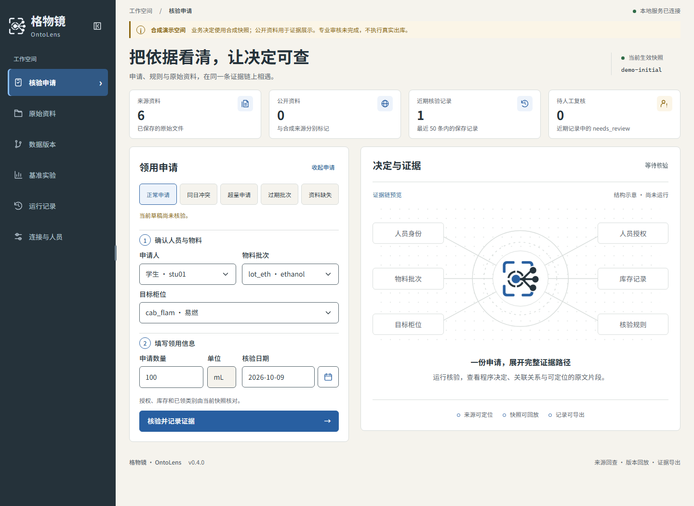
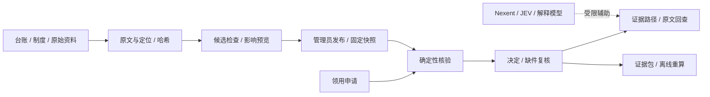

<p align="center">
  
</p>

# 格物镜 · OntoLens

**让实验室危化品领用核验有据可查、可复核、可重算。**

OntoLens 是面向实验室危化品领用流程的证据核验工作台。它将人员授权、物料批次、库存、柜位与规则绑定到同一份版本快照，由确定性程序给出决定；每个结果都能回到触发它的原文与规则。Nexent 与 JEV 提供编排、检索和解释辅助，业务决定始终由程序生成。

`v0.4.0` · `Python 3.11+` · `FastAPI` · `SQLite` · `MCP` · `Docker` · `Nexent`

[快速开始](#快速开始) · [核心设计](#核心设计) · [验证结果](#验证结果) · [演示与材料](#演示与材料) · [规划](docs/37-teammate-handoff.md) · [设计规范](design.md)



*实际运行界面，使用隔离合成台账。截图展示软件行为，不代表真实行业评测。*

## 解决什么问题

一次领用申请需要同时核对“谁有资格、哪个批次可用、库存够不够、放在哪个柜位、适用哪版规则”。这些事实散落在台账和制度中，资料变更后，过去的决定也需要有据可查。

OntoLens 将这条流程连起来：

1. 导入六类台账，保留原始字节、来源定位和规范化结果。
2. 检查候选及影响，由管理员确认发布有效版本。
3. 在固定快照下核验申请，返回决定、数量、原因和证据路径。
4. 打开原文、追加复核记录，或导出证据包在离线环境重新计算。

| 核验结果 | 含义 |
| --- | --- |
| `ALLOW` | 按规则允许申请数量 |
| `DENY` | 拒绝本次申请，保留原因 |
| `LIMIT` | 按规则限量，明确批准数量 |
| `ISOLATE` | 批次不应流通，拒绝领用 |
| `needs_review` | 资料缺失、冲突或失效，`decision=null`，列出补件项 |

核验结果供本单位审批流程使用，软件不直接执行真实出库。

## 核心设计

### 决定与解释分离

确定性内核读取可信快照中的授权、库存和规则。申请方不能注入“已授权”事实，模型也不能修改 `action`、批准数量或规则版本。资料不完整时进入复核，模型不可凭常识补齐并放行。

### 每条决定绑定证据

结果保留 `source_id`、`locator`、`quote`、`SHA256` 与版本快照。原文检查器和关系列表指向同一份来源；编辑申请后旧结果立即标为过期，历史记录保持当时的快照。

### 变更先预览，再发布

人员授权与制度更新先形成候选，检查引用、日期、单位和规则影响。发布/回滚需要管理员确认及 `expected_active` 比较，拒绝并发覆盖，保留历史版本。

### 导出后可以独立重算

证据包包含申请、规则、快照及所需来源的原始字节，离线校验器核对闭包、哈希、定位和复核绑定，重新计算决定。它证明包内一致性；来源真实性和专业适用性仍需业务方核验。



## 快速开始

### 业务工作区

需要 Python 3.11+、Git。核心核验可离线运行，Nexent、Docker 和在线模型为可选接入。

```bash
git clone https://git.fulao.cc/fulao/OntoLens.git
cd OntoLens
```

**Windows / PowerShell**

```powershell
python -m venv .venv
.\.venv\Scripts\python.exe -m pip install -e ".[workbench,jev,test]"
powershell -NoProfile -ExecutionPolicy Bypass -File .\start-operational.ps1 -Bootstrap
```

**Linux / macOS**

```bash
python3 -m venv .venv
.venv/bin/python -m pip install -e '.[workbench,jev,test]'
.venv/bin/python scripts/run_operational.py --bootstrap --host 127.0.0.1 --port 8768
```

打开 <http://127.0.0.1:8768/>。首次启动创建 `admin`，随机密码写入本机 `.runtime/operational/initial-admin.txt`。登录前在本机查看该文件，改密码并确认可登录后删除初始密码文件；后续启动省略 `-Bootstrap` / `--bootstrap`。

```powershell
.\.venv\Scripts\python.exe scripts/manage_access.py --auth-file .runtime/operational/accounts.json set-password admin
```

新业务库为空。登录后进入“原始资料”，下载模板、导入六类台账，检查候选并由管理员确认发布。首次账户、资料格式、模型配置、备份与对外部署详见[部署指南](docs/38-operational-deployment.md)。Windows 与 Docker Desktop 已实测；独立 Linux/macOS 新机安装仍列为待验。

### Docker

先按部署指南创建本机账户配置，再从仓库根目录执行：

```bash
docker compose -f deploy/compose.yaml up -d --build
```

容器以非 root 身份运行，数据保存在命名卷，账户配置只读挂载，默认端口仅映射至本机。停止使用 `docker compose -f deploy/compose.yaml stop`；[容器说明](deploy/README.md)包含备份、反向代理和 Nexent 网络接入。

### 合成演练

从仓库根目录启动独立演练库：

```powershell
$env:ONTOLENS_WORKSPACE_MODE = 'synthetic'
$env:ONTOLENS_DB = '.runtime/demo/workbench.sqlite3'
$env:ONTOLENS_LOAD_ENV = 'false'
.\.venv\Scripts\python.exe -m uvicorn ontolens.web:create_app --factory --host 127.0.0.1 --port 8767
```

该命令应在单独终端运行；关闭终端后不沿用演练环境变量启动业务库。演练使用明确标注的合成人员、库存及规则；[演示流程](submission/demo-runbook.md)给出完整操作顺序。

## 功能与技术栈

| 层 | 实现与用途 |
| --- | --- |
| 工作台 | 本地 HTML/CSS/JavaScript；可调宽侧栏、原文联动、日期/选择控件、键盘与减少动效 |
| 服务与权限 | FastAPI；管理员、操作者、复核者、只读用户；可撤销会话、CSRF与登录身份审计 |
| 数据与版本 | SQLite；六份原始 + 六份规范化台账、候选检查、影响预览、发布与回滚 |
| 核验内核 | Python 确定性规则；四种决定、缺件门禁、数量与有效期约束 |
| 证据复现 | 原始字节闭包导出、独立引用校验和离线重算 |
| 平台接入 | Nexent + MCP 七工具；单独的无工具辅助解释实例 |
| 可选模型 | TypeSafe JEV 证据重排；OpenAI/Anthropic 兼容解释接口 |

业务台账导入不授予外发权限。私有或未获准资料的解释请求只发送固定枚举和计数摘要；JEV 在线重排需要显式 `live=true`，且来源为非私有并获准外发。模型服务失效时，程序核验、普通检索和导出仍可用。

## 验证结果

每项数字对应自己的数据与检查范围。项目的[证据矩阵](submission/evidence-matrix.yaml)保留完整边界和未完成项。

| 检查 | 已取得结果 | 可核对证据 |
| --- | --- | --- |
| 软件回归 | 464项测试；pytest、浏览器、MCP、资产、JEV离线预检、依赖和JS语法七阶段通过 | [本地验证报告](artifacts/local-validation-report.json) |
| 合成规则留出集 | 60/60；该冻结夹具中 `unsafe_release=0` | [合成评估](artifacts/synthetic-evaluation-report.json) |
| 反事实边界 | 21/21；授权、库存、批次、柜位与单位变更 | [反事实收据](artifacts/synthetic-counterfactual-report.json) |
| 选择器与日期 | 各6项隔离浏览器测试通过 | [选择器](artifacts/workbench-select-interaction-report.json) / [日期](artifacts/workbench-date-interaction-report.json) |
| 容器业务流程 | 35项检查；新OntoLens入口、权限、导入发布、核验、导出、模型边界与重启持久化 | [命名迁移后容器收据](artifacts/operational-deployment-20261009-ontolens.json) |
| Nexent解释 | 同一中转供应商 `gpt-6-sol` 绑定、Agent2实际无工具解释 | [模型配置收据](artifacts/nexent-model-configuration-20261009.json) |

软件测试、合成规则评估和一次模型调用不代表行业准确率。真实台账独立标签评测、领域审核、长期负载、备份恢复、真实设备/读屏及独立新机验收仍在[规划](docs/37-teammate-handoff.md)中。

```powershell
.\.venv\Scripts\python.exe scripts/validate_local.py
.\.venv\Scripts\python.exe scripts/check_source_release.py --snapshot-validation
.\.venv\Scripts\python.exe scripts/audit_deliverables.py
.\.venv\Scripts\python.exe scripts/check_source_release.py --check-staged
```

验证使用隔离合成数据库，不对日常业务库运行写入测试。Linux/macOS 将 Python 路径换为 `.venv/bin/python`。

## 演示与材料

评审可以按以下顺序查看同一份申请：正常核验、超量/冲突/异常批次、缺件复核、打开原文、版本变更与回滚、导出离线重算。所有演练资料均注明性质。

| 入口 | 内容 |
| --- | --- |
| [演示流程](submission/demo-runbook.md) | 业务操作闭环、模型边界和失败演示 |
| [参赛材料](submission/README.md) | Word/PPT草稿、可编辑来源与证据矩阵 |
| [当前规划与里程碑](docs/37-teammate-handoff.md) | 完成、未完成、验收条件和拓展方向 |
| [部署指南](docs/38-operational-deployment.md) | 账户、台账、权限、备份、Docker与Nexent |
| [设计规范](design.md) | 设计索引及交互、动效、无障碍合同 |
| [源码交付](docs/36-source-layout.md) | 目录、白名单与历史证据范围 |

当前定位是可接授权业务资料的核验工作台。正式参赛提交、专业审核和真实行业效果各有独立验收，材料草稿不会把它们标为完成。

## 目录

```text
src/ontolens/    核验、证据、权限、HTTP/MCP与前端
src/peiwu/       旧Python入口的兼容层
data/           合成评估与公开来源摘录
tests/          契约、完整性和浏览器回归
scripts/        启动、验证、部署和交付工具
deploy/         容器定义
nexent/         接入模板与固定上游版本
design/         分篇设计规范
docs/           部署、规划和历史记录
submission/     参赛草稿与可编辑材料
artifacts/      经白名单筛选的验证证据
```

## 贡献与反馈

提交问题时附版本、复现步骤、预期/实际行为及脱敏日志。修改前阅读[设计规范](design.md)和[当前里程碑](docs/37-teammate-handoff.md)；核心行为变化需要有针对性的回归和新的验收收据。账户、密钥、上传文件、数据库与私有导出放在本机运行目录，不进入 Git。

项目统一使用 **格物镜 · OntoLens**。原 `peiwu` 包、`PEIWU_*` 配置、Nexent机器标识和导出协议属于历史兼容范围，详见[命名与兼容说明](docs/39-brand-compatibility.md)。它们不会被用作新的对外项目名称，也不会因改名而改写历史记录的哈希。

## 许可与致谢

仓库公开用于查阅与评审，目前尚未指定项目许可证，公开可见不自动授予复用许可。Nexent 与其他依赖按各自许可证使用；本仓库不包含它们的私有运行配置或完整 vendor 副本。

项目使用 [Nexent](https://github.com/ModelEngine-Group/nexent) 与 [TypeSafe](https://typesafe.ai/)。README 的阅读顺序参考 [Ruff](https://github.com/astral-sh/ruff) 和 Nexent 的项目说明，以实际实现与可复核结果为依据。
