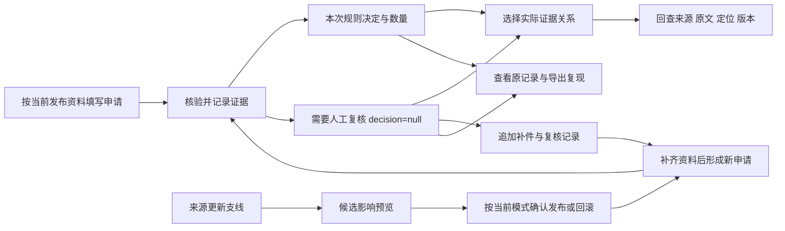

# 产品原则与真实任务

D1.1 · 2026-10-09 · 参考首页与可拉伸侧栏已决策，主实现已落地；完整验收与真实设备/读屏仍待完成。D1.0实现证据保留。

[返回设计规范目录](README.md)。MUST/SHOULD/MAY 强度见[产品原则](01-product-principles.md)。

## 1 规范地位与实现范围

根[design.md](../design.md)是唯一入口，本目录分篇共同构成本项目产品设计权威，适用于 `src/ontolens/static/` 的六个工作视图、共享组件和品牌素材；讨论取舍记录见[技能讨论](12-skill-discussion.md)。
**MUST（必须）**是不可省略的合同；**SHOULD（建议）**允许有记录的场景例外；**MAY（允许）**是可选增强。实现不能用另一项技能的默认模板替换本规范。
D1.0 已通过全体可取得技能咨询及交叉讨论形成决策；这不是代码完成、浏览器验收、真实用户研究或专业审核声明。
D1.1采用参考首页、深侧栏、大主句、四真实统计和六关系示意，优先于技能默认主题。认可的配色、线条和Logo保持；接口、证据语义和权限遵循工程合同。
产品名称 MUST 为“格物镜 · OntoLens”；包名、配置和源码入口使用 `ontolens` / `ONTOLENS_*`，接口与导出使用各自明确的版本契约。
新HTTP业务库默认operational_empty，带认证入口导入并发布获授权台账后为imported_workspace；显式synthetic演示/验证才是synthetic_demo。授权声明/公开条款不等于真实性或专业审核，程序不自动出库，按本单位流程审批。
模型解释、JEV、候选关系与人工追加记录 MUST NOT 覆盖确定性业务决定；`needs_review` 的 `decision=null` MUST 保留。
软件测试通过、单次 JEV 调用、历史平台成功与材料一致性 MUST NOT 写成行业准确率、生产可用、当前平台在线或专业背书。

## Overview

操作者的主任务是核对一份申请，了解决定及阻断原因，查看支持每条关系的原文，补齐缺件后重新核验，再回放或导出这次记录。
设计假设来自项目功能和任务分析，未取得真实用户研究结果；MUST NOT 虚构用户姓名、观察数据、收益指标或机构案例。
选定整体方向为**关系检证台**：决定、关系与原文能够对应核对；关系不是装饰，原文不是孤立文档，决定不是 AI 安全印章。
主签名 MUST 贯穿申请摘要、人/批次/柜位关系、真实证据路径、选中引用、来源版本与本次决定。
可调桌面侧栏和移动轻导航 MUST保留六视图，按“核验申请；原始资料、数据版本；基准实验、运行记录；连接与人员”组织，collapsed图标完整可命名。
来源更新与候选发布是核验主任务的支线，MUST NOT 强迫初次核验先创建候选；复核是本次记录内明确的追加操作。
导航、来源详情与历史查看 MUST 保留会话内草稿和选择；不为每次切页追加确认步骤。
只有确实将丢弃未保存输入的动作 SHOULD 明确提示恢复路径；可逆的阅读、选中与切页不增加权限询问。

v0.4.0优先比赛前端美观、操作体验和清楚展示：品牌旁44px折叠图标，删除长fold、冗余工作台卡、底部本地空间和visible宽控；保留真实actor/logout、边缘拖宽和键盘handle。软件可用业务流程与当前Nexent展示通过后进入发布检查；真实行业效果/专业复核/正式提交单独待验。

